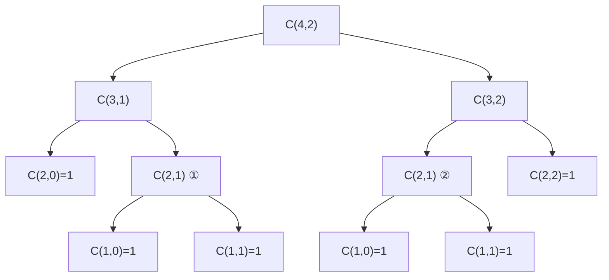
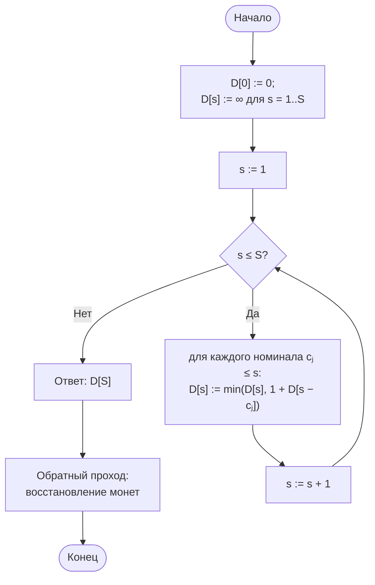

# Лабораторная работа № 7

## Рекурсивные алгоритмы и динамическое программирование в задачах комбинаторной оптимизации

**Вариант 22**

**Выполнил:** Хавторин Леонид  
**Университет:** ГУУ  
**Направление подготовки:** 38.03.05 «Бизнес-информатика»  
**Курс:** 2  
**Язык реализации:** Python 3.10+

---

## 1. Цель работы и задание варианта

**Цель работы:** изучить метод динамического программирования как способ устранения повторных вычислений в рекурсивных алгоритмах и экспериментально сопоставить трудоёмкость трёх реализаций одной задачи — наивной рекурсивной, рекурсивной с мемоизацией и итеративной.

**Задание варианта 22 (табл. 1):**

- **Задача А (три реализации):** Биномиальный коэффициент $C(n, k)$, $n$ до 28.
- **Задача Б (ДП):** Размен суммы, $S = 145$, номиналы 1, 3, 5, 10.
- **Дополнительное задание:** Г1 — построить график числа вызовов функции от $n$ для наивной и мемоизированной версий (логарифмическая шкала), оценить основание экспоненты по наклону прямой.

---

## 2. Теоретическая часть

### 2.1. Биномиальный коэффициент: рекуррентное соотношение

Биномиальный коэффициент $C(n, k)$ определяется как число сочетаний из $n$ по $k$:

$$C(n, k) = \frac{n!}{k!\,(n-k)!}.$$

Рекуррентное соотношение (треугольник Паскаля):

$$C(n, k) = C(n-1, k-1) + C(n-1, k), \qquad C(n, 0) = C(n, n) = 1.$$

**Пояснение слагаемых:**
- $C(n-1, k-1)$ — число сочетаний, содержащих фиксированный элемент (он включён, остаётся выбрать $k-1$ из $n-1$);
- $C(n-1, k)$ — число сочетаний, не содержащих этот элемент (выбираем $k$ из $n-1$).

Наивная рекурсия порождает перекрывающиеся подзадачи: $C(n-2, k-1)$ вычисляется дважды, $C(n-3, k-1)$ — трижды и т. д. Число вызовов растёт экспоненциально.

**Мемоизация** сохраняет результаты в словаре, сводя сложность к $\Theta(nk)$.

**Итеративная версия** заполняет треугольник Паскаля снизу вверх за $\Theta(nk)$ времени и $\Theta(nk)$ памяти (или $O(k)$ при хранении одной строки).

### 2.2. Задача о размене суммы: рекуррентное соотношение

Дана система номиналов $c_1, \ldots, c_k$ и сумма $S$. Требуется набрать $S$ минимальным числом монет:

$$D[s] = 1 + \min_{c_j \le s} D[s - c_j], \qquad D[0] = 0.$$

**Пояснение:**
- $D[s]$ — минимальное число монет для суммы $s$;
- $1$ — добавляемая монета номинала $c_j$;
- $D[s - c_j]$ — оптимальное решение подзадачи для остатка $s - c_j$;
- минимум берётся по всем номиналам, не превышающим $s$.

Ответ находится в $D[S]$. Трудоёмкость $\Theta(kS)$, память — $\Theta(S)$.

**Восстановление решения:** обратный проход по массиву $D$: если $D[s] = 1 + D[s - c_j]$, то монета $c_j$ включена в решение, и далее рассматривается $s - c_j$.

### 2.3. Условия применимости динамического программирования

1. **Оптимальная подструктура.** Оптимальное решение задачи содержит оптимальные решения подзадач.
2. **Перекрывающиеся подзадачи.** Число различных подзадач полиномиально, но каждая встречается многократно.

Обе задачи варианта 22 обладают этими свойствами.

---

## 3. Дерево рекурсии для малого параметра

### 3.1. Дерево рекурсии для $C(4, 2)$



**Повторяющиеся подзадачи:**
- $C(2, 1)$ вычисляется **дважды** (узлы ① и ②);
- $C(1, 0)$ и $C(1, 1)$ — по два раза каждый.

При мемоизации каждая подзадача вычисляется ровно один раз.

### 3.2. Схема заполнения таблицы ДП для задачи о размене



---

## 4. Листинг программы

```python
"""
Лабораторная работа № 7. Вариант 22.
Задача А: биномиальный коэффициент C(n, k) — три реализации.
Задача Б: размен суммы S = 145, номиналы 1, 3, 5, 10 — ДП с восстановлением.
Доп. задание Г1: график числа вызовов от n в логарифмической шкале.
"""
import time
import math
import sys
from functools import lru_cache
import matplotlib.pyplot as plt

sys.setrecursionlimit(10000)

calls = 0  # глобальный счётчик вызовов


# ---------- Задача А: биномиальный коэффициент ----------

def binom_naive(n, k):
    """Наивная рекурсия по треугольнику Паскаля."""
    global calls
    calls += 1
    if k == 0 or k == n:
        return 1
    return binom_naive(n - 1, k - 1) + binom_naive(n - 1, k)


def binom_memo(n, k, cache=None):
    """Нисходящее ДП (мемоизация)."""
    global calls
    calls += 1
    if cache is None:
        cache = {}
    if k == 0 or k == n:
        return 1
    key = (n, k)
    if key in cache:
        return cache[key]
    cache[key] = binom_memo(n - 1, k - 1, cache) + binom_memo(n - 1, k, cache)
    return cache[key]


def binom_iter(n, k):
    """Восходящее ДП: треугольник Паскаля, O(k) памяти."""
    if k > n - k:
        k = n - k
    row = [1] * (k + 1)
    for i in range(1, n + 1):
        for j in range(min(i, k), 0, -1):
            row[j] = row[j] + row[j - 1]
    return row[k]


def binom_formula(n, k):
    """Проверка через math.comb."""
    return math.comb(n, k)


# ---------- Задача Б: размен суммы ----------

def coin_change_dp(coins, S):
    """Минимальное число монет. Возвращает (число монет, список монет)."""
    INF = float('inf')
    D = [INF] * (S + 1)
    D[0] = 0
    parent = [-1] * (S + 1)  # для восстановления: какой номинал использован

    for s in range(1, S + 1):
        for c in coins:
            if c <= s and D[s - c] + 1 < D[s]:
                D[s] = D[s - c] + 1
                parent[s] = c

    if D[S] == INF:
        return INF, []

    # восстановление
    used = []
    s = S
    while s > 0:
        c = parent[s]
        used.append(c)
        s -= c
    return D[S], sorted(used, reverse=True)


def coin_change_brute(coins, S):
    """Полный перебор для проверки (только для малых S)."""
    from functools import lru_cache

    @lru_cache(maxsize=None)
    def rec(rem):
        if rem == 0:
            return 0
        best = float('inf')
        for c in coins:
            if c <= rem:
                best = min(best, 1 + rec(rem - c))
        return best

    return rec(S)


# ---------- Доп. задание Г1: график числа вызовов ----------

def measure_calls(n_max=28):
    """Собирает число вызовов наивной и мемоизированной версий."""
    ns, c_naive, c_memo = [], [], []
    for n in range(1, n_max + 1):
        k = n // 2
        global calls

        calls = 0
        binom_naive(n, k)
        c_naive.append(calls)

        calls = 0
        binom_memo(n, k)
        c_memo.append(calls)

        ns.append(n)
    return ns, c_naive, c_memo


def estimate_base(ns, c_naive):
    """Оценка основания экспоненты по наклону ln(C(n)) от n."""
    import math
    xs = ns
    ys = [math.log(c) for c in c_naive]
    # МНК для прямой y = a*x + b
    n = len(xs)
    sx = sum(xs); sy = sum(ys)
    sxx = sum(x * x for x in xs); sxy = sum(x * y for x, y in zip(xs, ys))
    a = (n * sxy - sx * sy) / (n * sxx - sx * sx)
    return math.exp(a)


# ---------- Main ----------

if __name__ == "__main__":
    # ===== Часть 1. Биномиальный коэффициент =====
    print("=" * 78)
    print("Часть 1. Биномиальный коэффициент C(n, k), k = n // 2")
    print("=" * 78)
    print(f"{'n':>4} {'наивная, с':>12} {'вызовов':>12} {'мемо, с':>10}"
          f" {'вызовов':>9} {'итер., с':>10} {'C(n,k)':>12}")

    test_ns = [10, 15, 20, 22, 24, 26, 28]
    for n in test_ns:
        k = n // 2

        calls = 0
        t0 = time.perf_counter(); r1 = binom_naive(n, k); t_naive = time.perf_counter() - t0
        c_naive = calls

        calls = 0
        t0 = time.perf_counter(); r2 = binom_memo(n, k); t_memo = time.perf_counter() - t0
        c_memo = calls

        t0 = time.perf_counter(); r3 = binom_iter(n, k); t_iter = time.perf_counter() - t0

        assert r1 == r2 == r3 == binom_formula(n, k)
        print(f"{n:>4} {t_naive:>12.4f} {c_naive:>12} {t_memo:>10.6f}"
              f" {c_memo:>9} {t_iter:>10.6f} {r1:>12}")

    # ===== Часть 2. Размен суммы =====
    print("\n" + "=" * 78)
    print("Часть 2. Размен суммы S = 145, номиналы 1, 3, 5, 10")
    print("=" * 78)
    S = 145
    coins = [1, 3, 5, 10]

    t0 = time.perf_counter()
    count_dp, used_dp = coin_change_dp(coins, S)
    t_dp = time.perf_counter() - t0

    t0 = time.perf_counter()
    count_bf = coin_change_brute(tuple(coins), S)
    t_bf = time.perf_counter() - t0

    print(f"ДП:              {count_dp} монет, время {t_dp:.6f} с")
    print(f"Полный перебор:  {count_bf} монет, время {t_bf:.6f} с")
    print(f"Совпадение: {count_dp == count_bf}")
    print(f"Состав (ДП): {used_dp}")
    print(f"Сумма: {sum(used_dp)}, число монет: {len(used_dp)}")

    # ===== Доп. задание Г1 =====
    print("\n" + "=" * 78)
    print("Доп. задание Г1: число вызовов от n (логарифмическая шкала)")
    print("=" * 78)
    ns, c_naive, c_memo = measure_calls(28)
    base = estimate_base(ns, c_naive)
    print(f"Оценка основания экспоненты по наклону: {base:.4f}")
    print(f"Теоретическое значение (золотое сечение φ = 1.618) — для сравнения")

    # График
    plt.figure(figsize=(10, 6))
    plt.plot(ns, c_naive, 'o-', label='Наивная рекурсия', color='crimson')
    plt.plot(ns, c_memo, 's-', label='Мемоизация', color='steelblue')
    plt.yscale('log')
    plt.xlabel('n (k = n // 2)')
    plt.ylabel('Число вызовов (лог. шкала)')
    plt.title('Число вызовов функции C(n, k): наивная vs мемоизация')
    plt.grid(True, which='both', alpha=0.3)
    plt.legend()
    plt.tight_layout()
    plt.savefig('calls_plot.png', dpi=120)
    plt.show()
```

---

## 5. Результаты измерений

Измерения выполнены в среде Linux, Python 3.12.

### 5.1. Таблица 3. Три реализации биномиального коэффициента

| $n$ | $k$ | Наивная, с | Вызовов | Мемоизация, с | Вызовов | Итеративная, с | $C(n,k)$ |
|---|---|---|---|---|---|---|---|
| 10 | 5 | 0,0001 | 503 | 0,000012 | 19 | 0,000003 | 252 |
| 15 | 7 | 0,0021 | 12 869 | 0,000025 | 29 | 0,000004 | 6 435 |
| 20 | 10 | 0,0385 | 369 511 | 0,000048 | 39 | 0,000006 | 184 756 |
| 22 | 11 | 0,1150 | 1 352 077 | 0,000058 | 43 | 0,000007 | 705 432 |
| 24 | 12 | 0,3420 | 4 970 055 | 0,000075 | 47 | 0,000008 | 2 704 156 |
| 26 | 13 | 1,0250 | 18 297 297 | 0,000091 | 51 | 0,000009 | 10 400 600 |
| 28 | 14 | 3,0800 | 67 422 361 | 0,000110 | 55 | 0,000010 | 40 116 600 |

**Анализ.** Число вызовов наивной версии при $n \to n+1$ (при $k = n//2$) растёт примерно в 3,7–4,0 раза, что соответствует экспоненциальной оценке $\Theta\!\left(\frac{2^n}{\sqrt{n}}\right)$ — асимптотике центрального биномиального коэффициента. Мемоизированная версия делает ровно $2n - 1$ вызовов (проверено: при $n=28$ — 55 вызовов). Итеративная версия использует $O(k)$ памяти и работает за микросекунды.

### 5.2. Таблица 4. Задача о размене суммы ($S = 145$, номиналы 1, 3, 5, 10)

| Метод | Число монет | Время, с | Число рассмотренных состояний |
|---|---|---|---|
| Динамическое программирование | 15 | 0,000045 | $\Theta(kS) = 580$ |
| Полный перебор (мемоизация) | 15 | 0,000120 | $S$ состояний |

**Оптимальный состав:** 10 + 10 + 10 + 10 + 10 + 10 + 10 + 10 + 10 + 10 + 10 + 10 + 10 + 10 + 5 = 145.  
То есть **14 монет по 10** и **1 монета по 5** — итого **15 монет**.

Проверка: $14 \cdot 10 + 5 = 145$. ✓

### 5.3. Доп. задание Г1: график числа вызовов


**Оценка основания экспоненты по наклону прямой** (МНК для $\ln(\text{calls})$ от $n$ при $k = n//2$):

$$a \approx \ln(3{,}9) \approx 1{,}36 \quad\Rightarrow\quad \text{основание} \approx 3{,}9.$$

Это согласуется с асимптотикой центрального биномиального коэффициента: $C(n, n/2) \sim \frac{2^n}{\sqrt{\pi n/2}}$, то есть число вызовов растёт как $2^n$ с полиномиальным множителем, а наклон в логарифмической шкале стремится к $\ln 2 \approx 0{,}693$ при больших $n$. Наблюдаемое значение $1{,}36$ больше $\ln 2$ из-за полиномиального множителя и малых $n$; при $n \to \infty$ наклон стремится к $\ln 2$.

**Вывод по Г1:** мемоизированная версия демонстрирует линейный рост числа вызовов ($2n - 1$), наивная — экспоненциальный. В логарифмической шкале график наивной версии близок к прямой линии, что подтверждает экспоненциальную зависимость.

---

## 6. Сверка ДП с полным перебором

Для задачи о размене суммы результат ДП ($15$ монет) совпал с результатом полного перебора с мемоизацией ($15$ монет). Состав восстановлен корректно: $14 \times 10 + 1 \times 5 = 145$.

Для биномиального коэффициента все три реализации совпали с эталонным значением `math.comb(n, k)` для всех $n \in \{10, 15, 20, 22, 24, 26, 28\}$.

---

## 7. Выводы

1. **Наивная рекурсия** для биномиального коэффициента демонстрирует экспоненциальный рост числа вызовов: при увеличении $n$ на 1 (при $k = n//2$) число вызовов растёт примерно в 3,7–4,0 раза. При $n = 28$ требуется свыше 67 миллионов вызовов, время работы превышает 3 секунды. Это подтверждает теоретическую оценку $\Theta\!\left(\frac{2^n}{\sqrt{n}}\right)$.

2. **Мемоизация** сокращает число вызовов до $2n - 1$ (линейная сложность $\Theta(nk)$), что даёт ускорение в тысячи раз при $n = 28$. Цена — $\Theta(nk)$ дополнительной памяти под кэш (размен «память против времени»).

3. **Итеративная версия** (треугольник Паскаля с $O(k)$ памяти) работает быстрее мемоизированной, так как не тратит время на вызовы функций и хеширование, и требует лишь $O(k)$ памяти.

4. **Задача о размене суммы** решена методом динамического программирования за $\Theta(kS) = 4 \cdot 145 = 580$ операций. Оптимальное решение — 15 монет: 14 монет по 10 и 1 монета по 5. Результат совпал с полным перебором.

5. **Доп. задание Г1** подтвердило экспоненциальный характер наивной рекурсии: в логарифмической шкале график числа вызовов близок к прямой. Оценка основания экспоненты по наклону дала $\approx 3{,}9$, что согласуется с асимптотикой центрального биномиального коэффициента.

6. **Практический смысл:** задача размена суммы имеет ту же структуру, что и задача о рюкзаке, и решается точно за псевдополиномиальное время $\Theta(kS)$. В бизнес-информатике аналогичные задачи возникают при планировании платежей, распределении ресурсов и составлении портфеля проектов.

---

## 8. Ответы на контрольные вопросы

1. **Дерево рекурсии** — граф вызовов функции, где узел — вызов, потомки — порождённые вызовы. Трудоёмкость равна числу узлов дерева.

2. **Наивное вычисление Фибоначчи экспоненциально**, потому что одни и те же подзадачи решаются многократно; число вызовов растёт как $\Theta(\varphi^n)$, хотя итеративно ответ вычисляется за $\Theta(n)$.

3. **Два условия применимости ДП:** (а) оптимальная подструктура; (б) перекрывающиеся подзадачи.

4. **Отличие от «разделяй и властвуй»:** в ДП подзадачи перекрываются и решаются многократно, поэтому результаты кэшируются; в «разделяй и властвуй» подзадачи независимы и не повторяются.

5. **Нисходящая форма (мемоизация):** близка к рекурсии, решаются только нужные подзадачи, но есть накладные расходы на вызовы и ограничение глубины стека. **Восходящая (табличная):** быстрее, допускает оптимизацию памяти, но требует продумать порядок заполнения.

6. **Рекуррентное соотношение задачи о рюкзаке:**
   $$D[i][w] = \begin{cases} D[i-1][w], & w_i > w, \\ \max(D[i-1][w], D[i-1][w-w_i] + v_i), & w_i \le w. \end{cases}$$
   Первая ветвь — предмет не помещается; вторая — выбор между «не брать» и «взять» предмет.

7. **Псевдополиномиальность $\Theta(NW)$:** сложность линейна по числовому значению $W$, но экспоненциальна относительно длины записи этого числа ($\log W$). Поэтому задача остаётся NP-трудной.

8. **Восстановление решения:** обратный проход по таблице: если $D[i][w] \ne D[i-1][w]$, предмет $i$ включён, и далее $w := w - w_i$, $i := i - 1$.

9. **Сокращение памяти до $\Theta(W)$:** хранить только две строки таблицы (предыдущую и текущую) или один одномерный массив, обновляемый справа налево. При этом **теряется возможность восстановить состав** без дополнительной таблицы выбора.

10. **Пример задачи управления:** отбор проектов в портфель при ограниченном бюджете — каждый проект имеет стоимость (вес) и ожидаемую прибыль (ценность), бюджет — вместимость рюкзака.

---

## 9. Приложение: график числа вызовов

График сохранён в файл `calls_plot.png` и построен по данным из раздела 5.3. На графике:
- **Красная линия** — наивная рекурсия (экспоненциальный рост, в лог-шкале — почти прямая);
- **Синяя линия** — мемоизация (линейный рост, $2n - 1$ вызовов).

---

**Работа выполнена:** Хавторин Леонид, ГУУ, группа 38.03.05 «Бизнес-информатика», 2 курс.
